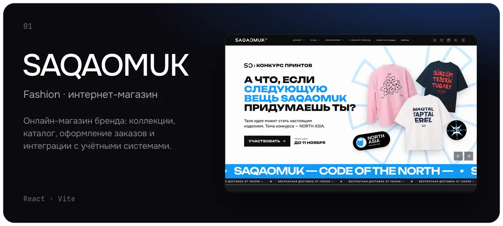
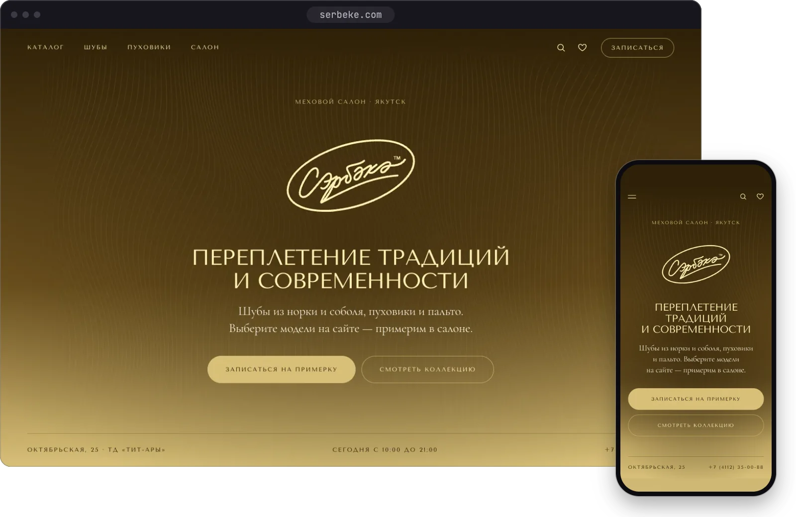
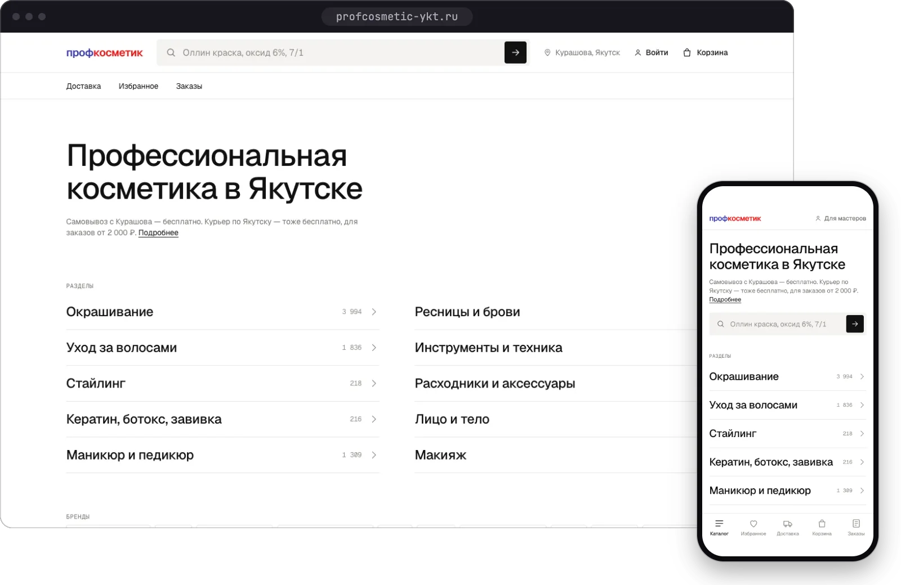
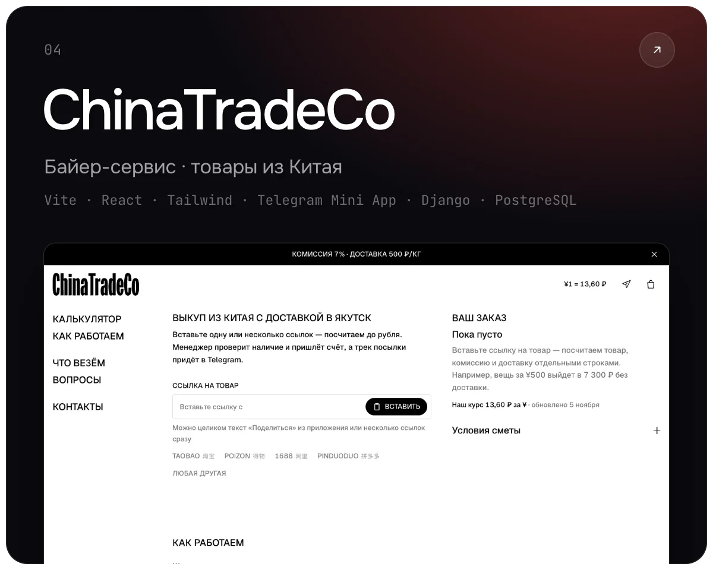
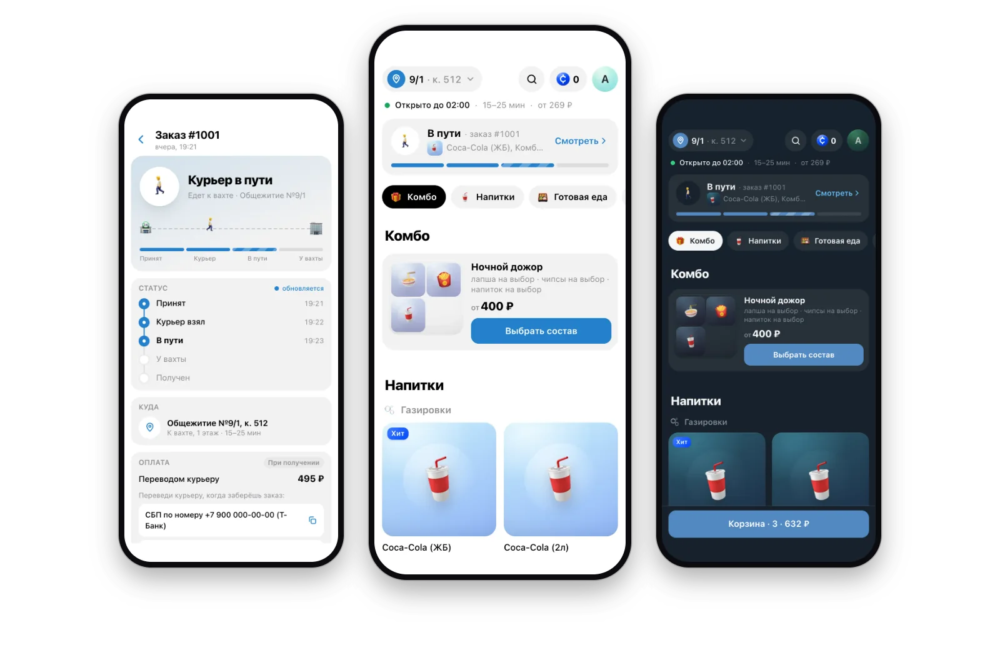
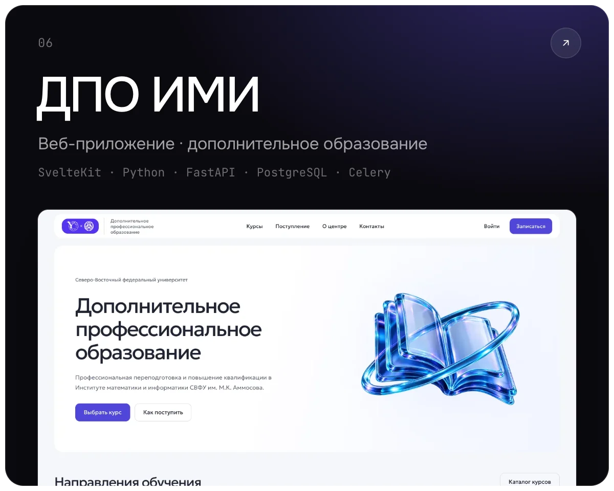
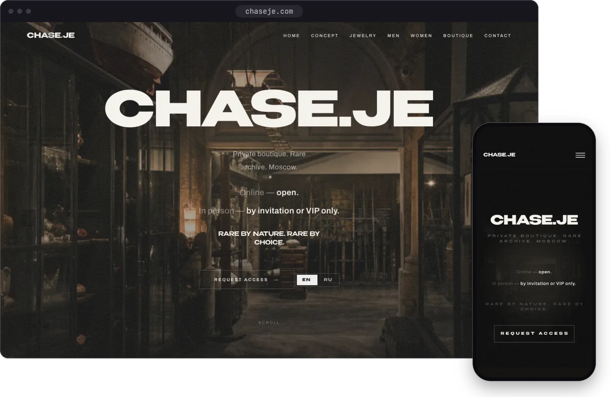
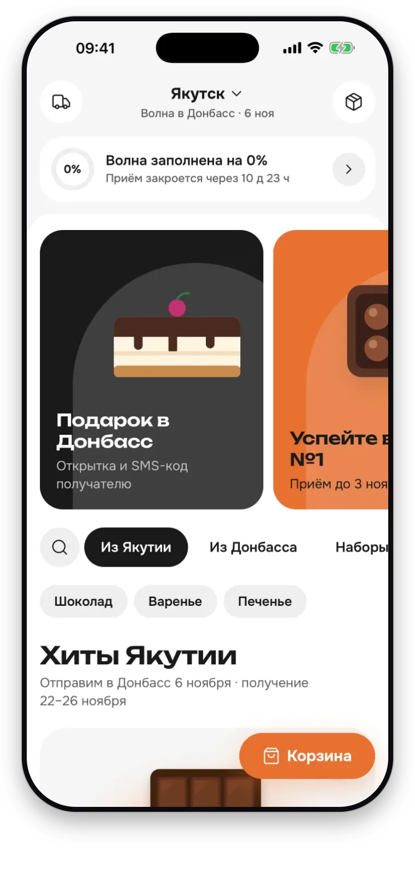
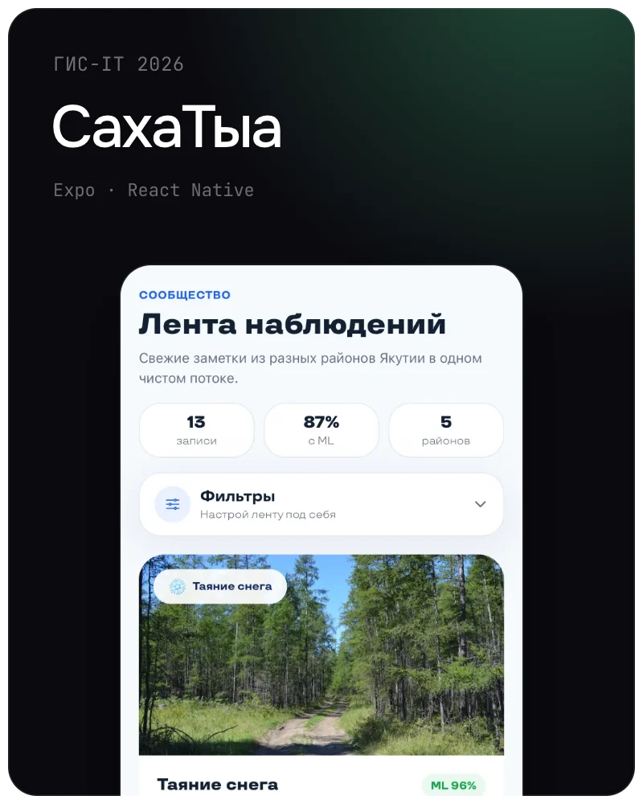
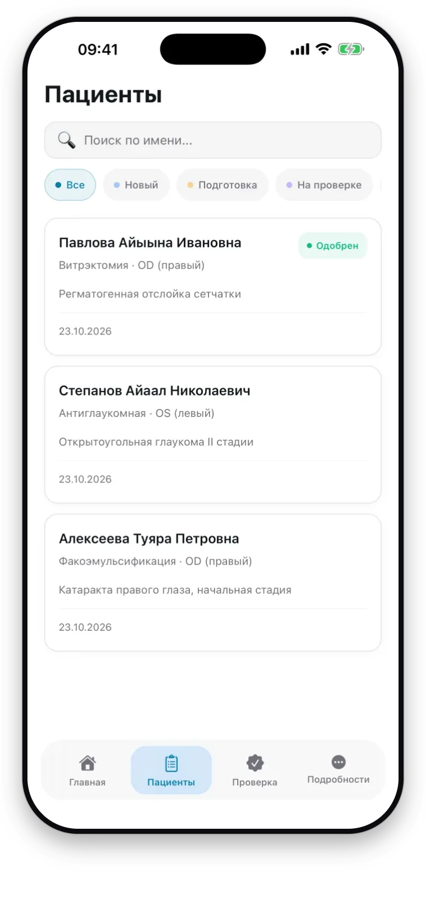

<a href="https://xrtem.dev">
  <picture>
    <source media="(prefers-color-scheme: dark)" srcset="assets/wordmark-dark.webp">
    
  </picture>
</a>

### Артём Свинобоев · fullstack-разработчик из Якутска

С 2022 года собираю сайты и сервисы под ключ —
от макета до админки, которой владелец пользуется сам.

**[xrtem.dev](https://xrtem.dev)** &nbsp;·&nbsp; [Telegram](https://t.me/stelmahhh) &nbsp;·&nbsp; [batteryofsprunk@gmail.com](mailto:batteryofsprunk@gmail.com)

 

**SAQAOMUK** — интернет-магазин модного бренда: коллекции, каталог, оформление заказа,
админка для команды и обмен данными с учётными системами.

<code>React</code> <code>Vite</code> &nbsp;·&nbsp; 2026 &nbsp;·&nbsp; в продакшене

[Кейс](https://xrtem.dev/work/saqaomuk) &nbsp;·&nbsp; [saqaomuk.com](https://saqaomuk.com)

 

## Проекты

Работающие продукты и их настоящие экраны. Каждый разобран на [xrtem.dev](https://xrtem.dev/#work).

<table>
  <tr>
    <td width="50%" valign="top">
      
      <h3>Сэрбэкэ</h3>
      Меховой салон · сайт и запись на примерку
      
Коллекция и запись, при которой салон откладывает выбранный размер до визита. Онлайн-продаж нет: покупка происходит в салоне.

      <code>Next.js</code> <code>React</code> <code>TypeScript</code> <code>Tailwind</code>
      
<a href="https://xrtem.dev/work/serbeke">Кейс</a> &nbsp;·&nbsp; <a href="https://serbeke.vercel.app">serbeke.com</a>

    </td>
    <td width="50%" valign="top">
      
      <h3>Профкосметик</h3>
      Интернет-магазин · профессиональная косметика
      
Каталог из более чем 10 тысяч товаров восьмидесяти брендов, поиск, корзина, заказы и цены по договору для салонов и мастеров.

      <code>Next.js</code> <code>React</code>
      
<a href="https://xrtem.dev/work/profcosmetic">Кейс</a> &nbsp;·&nbsp; <a href="https://profcosmetic-ykt.ru">profcosmetic-ykt.ru</a>

    </td>
  </tr>
  <tr>
    <td width="50%" valign="top">
      
      <h3>ChinaTradeCo</h3>
      Байер-сервис · товары из Китая
      
Выкуп с Taobao, 1688, Pinduoduo и Poizon с доставкой в Якутск: калькулятор считает заказ по ссылке, статусы приходят в Telegram Mini App, менеджеры работают в админке.

      <code>React</code> <code>Vite</code> <code>Tailwind CSS</code> <code>Telegram Mini App</code> <code>Django</code> <code>PostgreSQL</code>
      
<a href="https://xrtem.dev/work/chinatradeco">Кейс</a> &nbsp;·&nbsp; <a href="https://chinatradeco.app">chinatradeco.app</a>

    </td>
    <td width="50%" valign="top">
      
      <h3>СтудМаркет</h3>
      Telegram Mini App · сервис доставки
      
Магазин напитков и снеков с доставкой к вахте общежития СВФУ: Mini App для заказов, бот для курьеров и админка. Около 100 заказов в день.

      <code>Python</code> <code>FastAPI</code> <code>aiogram</code> <code>PostgreSQL</code> <code>React</code> <code>TypeScript</code>
      
<a href="https://xrtem.dev/work/studmarket">Кейс</a> &nbsp;·&nbsp; <a href="https://t.me/StudMarketNEFU_Bot">@StudMarketNEFU_Bot</a>

    </td>
  </tr>
  <tr>
    <td width="50%" valign="top">
      
      <h3>ДПО ИМИ</h3>
      Веб-приложение · дополнительное образование
      
Сайт и кабинет учебного центра ИМИ СВФУ: каталог программ, заявление с документами и оплатой, кабинеты администратора и преподавателей.

      <code>Svelte</code> <code>SvelteKit</code> <code>Python</code> <code>FastAPI</code> <code>PostgreSQL</code> <code>Celery</code>
      
<a href="https://xrtem.dev/work/dpo-imi">Кейс</a> &nbsp;·&nbsp; на тестовом стенде вуза

    </td>
    <td width="50%" valign="top">
      
      <h3>Chase.je</h3>
      Частный бутик · имиджевый сайт
      
Атмосферный сайт бутика-архива на двух языках: редкие вещи, доступ по запросу и сдержанная подача.

      <code>HTML</code> <code>CSS</code> <code>JavaScript</code>
      
<a href="https://xrtem.dev/work/chaseje">Кейс</a> &nbsp;·&nbsp; <a href="https://chaseje.com">chaseje.com</a>

    </td>
  </tr>
</table>

## Хакатоны

В команде beercut на хакатонах я делал мобильные приложения на Expo и React Native. Экраны сняты в симуляторе iPhone на демо-данных.

<table>
  <tr>
    <td width="33%" valign="top" align="center">
      
      <h3>Сладкий мост</h3>
      Peak IT 2026
      
Маркетплейс сладостей между Якутском и Донецком. Заказы едут сборными «волнами», и тариф доставки падает по мере заполнения волны.

    </td>
    <td width="33%" valign="top" align="center">
      
      <h3>СахаТыа</h3>
      ГИС-IT 2026
      
Дневник сезонных наблюдений в Якутии: лента, каталог из 28 видов, карта и очередь, которая синхронизируется, когда появляется связь.

    </td>
    <td width="33%" valign="top" align="center">
      
      <h3>Oculus-Feldsher</h3>
      Февраль 2026 · <a href="https://github.com/beercut-team-old/mobile">код</a>
      
Подготовка офтальмологических пациентов к операции: роли, чек-листы анализов, карточка с PDF и калькулятор ИОЛ.

    </td>
  </tr>
</table>

## Что я делаю

<table>
  <tr><td><b>Сайты и лендинги</b></td><td>Для компаний, брендов и запусков. Анимации, CMS, SEO и скорость из коробки.</td></tr>
  <tr><td><b>Интернет-магазины</b></td><td>Каталог, корзина, оплата и админка, которой владелец правда пользуется.</td></tr>
  <tr><td><b>Платформы и кабинеты</b></td><td>Роли, мультитенантность, отчёты. FastAPI, PostgreSQL, Next.js.</td></tr>
  <tr><td><b>Telegram-боты и Mini Apps</b></td><td>Лояльность, запись, рассылки — связанные с вашим сайтом и CRM.</td></tr>
  <tr><td><b>Интеграции</b></td><td>1С, CRM, эквайринг, аналитика. Данные ходят сами, без ручной выгрузки.</td></tr>
</table>

Беру на себя макет, фронтенд, бэкенд, интеграции и запуск. Якутск, UTC+9. Русский, English.

## Контакты

Есть проект — напишите: [Telegram](https://t.me/stelmahhh), [batteryofsprunk@gmail.com](mailto:batteryofsprunk@gmail.com) или через [xrtem.dev](https://xrtem.dev/#contact).

 

<b>English</b>

 

**Artem Svinoboev, a full-stack developer from Yakutsk.** Since 2022 I've been building sites and services end to end — from the first layout to an admin panel the owner actually uses.

**Projects** — each one has a case page on [xrtem.dev](https://xrtem.dev/#work).

- **[SAQAOMUK](https://xrtem.dev/work/saqaomuk)** — the online store of a fashion brand: collections, catalogue, checkout, an admin panel and data exchange with the brand's back-office systems. [saqaomuk.com](https://saqaomuk.com)
- **[Сэрбэкэ](https://xrtem.dev/work/serbeke)** — a site for a fur salon in Yakutsk: the collection, and a booking that holds the chosen size until the visit. [serbeke.com](https://serbeke.vercel.app)
- **[Профкосметик](https://xrtem.dev/work/profcosmetic)** — an online store of professional cosmetics: over ten thousand items from eighty brands, search, a cart, orders, and prices by contract for salons and masters. [profcosmetic-ykt.ru](https://profcosmetic-ykt.ru)
- **[ChinaTradeCo](https://xrtem.dev/work/chinatradeco)** — a service that buys goods on Taobao, 1688, Pinduoduo and Poizon and brings them to Yakutsk: a calculator that counts an order from a link, a Telegram Mini App with order statuses, and an admin for the managers. [chinatradeco.app](https://chinatradeco.app)
- **[СтудМаркет](https://xrtem.dev/work/studmarket)** — a drinks and snacks shop that delivers to the dorm lobby at NEFU: a Mini App for orders, a bot for couriers and an admin panel. About 100 orders a day. [@StudMarketNEFU_Bot](https://t.me/StudMarketNEFU_Bot)
- **[ДПО ИМИ](https://xrtem.dev/work/dpo-imi)** — a site and a cabinet for the continuing-education centre of the Institute of Mathematics and Informatics at NEFU: a programme catalogue, an application with documents and payment, and offices for the administrator and teachers. On the university's test stand.
- **[Chase.je](https://xrtem.dev/work/chaseje)** — an atmospheric site for a private archive boutique, in two languages: rare pieces, access by request and a deliberately restrained presentation. [chaseje.com](https://chaseje.com)

**Hackathons** — with the beercut team I built the mobile apps, in Expo and React Native: Сладкий мост (Peak IT 2026), a marketplace for sweets between Yakutsk and Donetsk; СахаТыа (GIS-IT 2026), a diary of seasonal observations in Yakutia; [Oculus-Feldsher](https://github.com/beercut-team-old/mobile), a system that prepares eye patients for surgery.

**What I do** — websites and landing pages, online stores, platforms and dashboards, Telegram bots and Mini Apps, integrations with 1C, CRM and acquiring.

**Contact** — [Telegram](https://t.me/stelmahhh), [batteryofsprunk@gmail.com](mailto:batteryofsprunk@gmail.com), [xrtem.dev](https://xrtem.dev).

